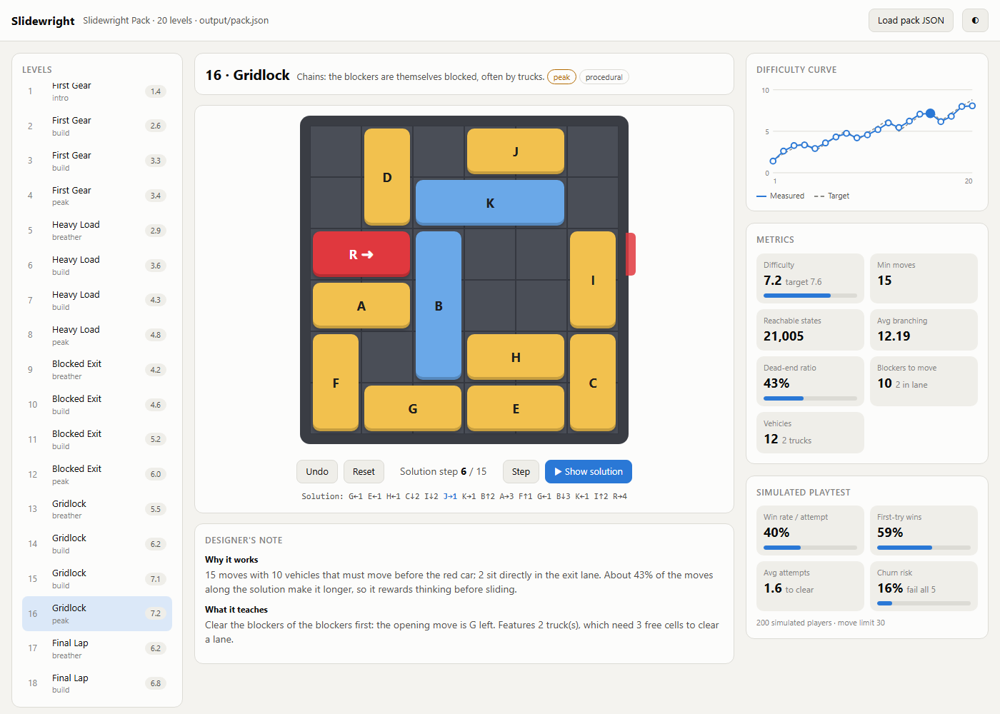
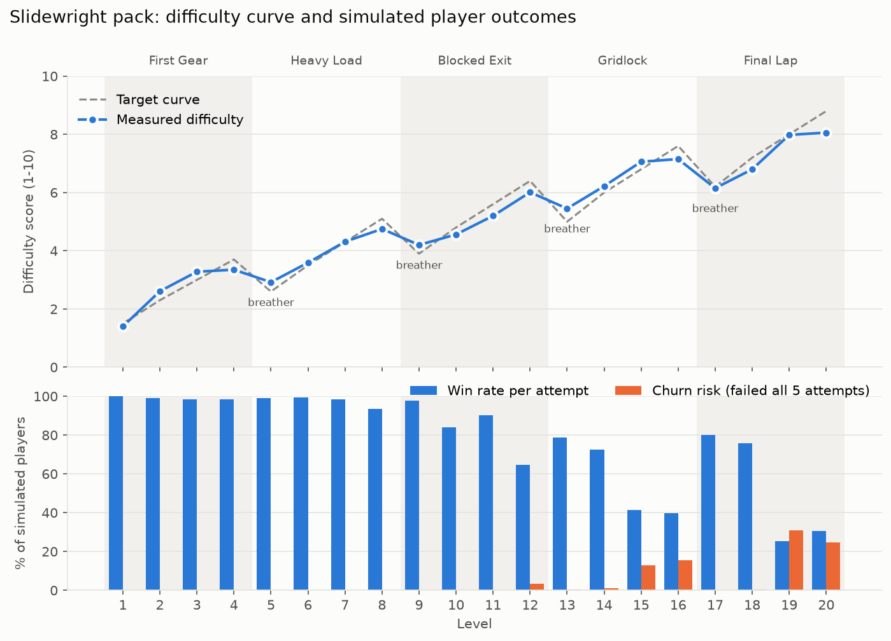
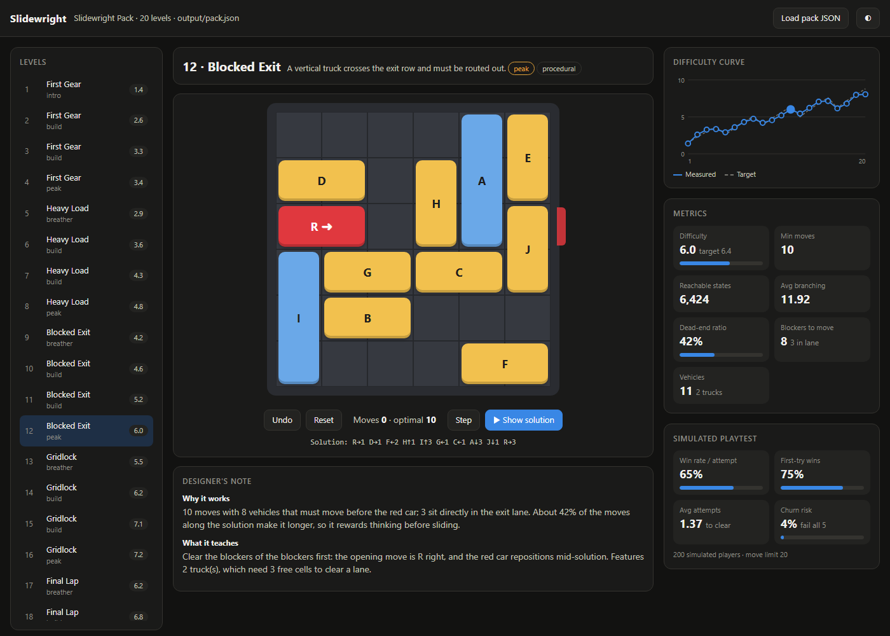

# Slidewright

**An AI-assisted level design tool for a mobile car-escape puzzle** (the sliding-block "get the red car out" genre).
It generates 6×6 layouts with Claude or procedurally, proves each one is solvable, scores its difficulty from the
structure of its state space, runs 200 simulated players on it, and assembles a 20-level pack along a designed
difficulty curve. A single-file HTML viewer lets you play every level, read its numbers and watch the optimal solution.

**▶ [Play the 20-level pack in your browser](https://erenyagmur.github.io/slidewright/viewer.html)**, or see the
[Claude design-session levels](https://erenyagmur.github.io/slidewright/viewer.html?pack=output/claude_session/pack.json).



## Why this matters for a live puzzle game

A live puzzle game ships levels every week, and its retention depends on getting the difficulty curve right: one
spike that's too hard and players churn, one stretch that's too flat and they get bored. Live teams track **win
rate, attempts per level and churn after a level** for exactly this reason. Slidewright moves that loop *before* launch:

| Live-ops question | What Slidewright gives you before shipping |
|---|---|
| Is the level even beatable? Is there a shortcut? | BFS solver: solvable yes/no, exact minimum moves, the optimal line |
| How hard is it? | A 1–10 score from five structural metrics, with a published formula |
| Will players get stuck here? | Simulated win rate, attempts-to-clear and churn risk from 200 player agents |
| Does the pack flow? | A designed sawtooth curve, and a chart of target vs measured difficulty |
| Can we make 50 more like level 12? | Natural-language brief → Claude proposals → solver-verified levels with designer notes |

The AI never has the final say: **every AI-proposed layout is checked by the solver**, and off-target layouts are
sent back with concrete feedback ("optimal solution is 6 moves, target is 12–18").

## What's in the box

```
solver.py          board model, move rules, BFS solver, full state-graph exploration
metrics.py         difficulty metrics + 1-10 score
playtest.py        simulated players (randomness + limited lookahead), 200 runs per level
generator.py       procedural generator with constraints (difficulty, trucks, moves, mechanic)
ai_generator.py    Claude pipeline: brief -> spec -> variants -> solver check -> feedback -> notes
designer_session.py  the same validation loop driven by round files (no API key needed)
pack_builder.py    20-level pack along a sawtooth curve + matplotlib chart
slidewright.py          CLI
viewer.html        single-file viewer: play, metrics, designer note, animated solution
tests/             pytest: move rules, solver, metrics, playtest, generator, AI loop (mocked API)
levels/            example level JSON
output/            generated pack.json, difficulty_curve.png, generated.json
```

## Run it

```bash
pip install -r requirements.txt
```

```bash
python -m pytest
```

```bash
python slidewright.py pack --count 20
```

```bash
python slidewright.py view
```

Other commands:

```bash
python slidewright.py solve levels/example.json
python slidewright.py analyze levels/example.json --playtest
python slidewright.py random --difficulty 5-7 --trucks 1-2 --min-moves 10 --exit-truck --count 3
python slidewright.py generate --brief "level 12, medium-hard, introduce trucks blocking the exit row, about 15 moves"
```

Set `ANTHROPIC_API_KEY` to use Claude for `generate` and `pack` (`--mode ai|procedural|auto`, default `auto`).
Without a key, both commands fall back to the procedural generator and template designer notes, so everything
still runs. `viewer.html` loads `output/pack.json` when served (`slidewright.py view`); when you open it straight from disk,
use **Load pack JSON** or drag a file onto the page.

## Game rules and level format

6×6 grid. Cars are 2 cells, trucks 3, horizontal (`H`) or vertical (`V`); they slide only along their axis and
never through each other. The red car `R` is horizontal on the third row (`y = 2`, zero-based) and wins when it
reaches the exit on the right edge. **One move = one slide of any length**, the way players count moves.

```json
{
  "name": "Example: chain of blockers",
  "grid": {"width": 6, "height": 6},
  "exit": {"row": 2, "side": "right"},
  "vehicles": [
    {"id": "R", "x": 0, "y": 2, "length": 2, "orientation": "H"},
    {"id": "A", "x": 2, "y": 0, "length": 3, "orientation": "V"},
    {"id": "C", "x": 4, "y": 1, "length": 2, "orientation": "V"}
  ]
}
```

## How it works

### 1. Solver
Each vehicle has one free coordinate, so a state is a tuple of ints, and each vehicle's cells at each position are
precomputed as a 36-bit mask. A collision check is a single `&`. `solve()` is a BFS that returns
`solvable`, `min_moves` and the optimal `path`. `explore()` enumerates the whole reachable component (up to ~50k
states on a jammed board, well under a second) and runs a multi-source BFS back from every goal state, which gives
**the exact distance to the exit from every reachable position**. The metrics and the generator are built on that.

### 2. How difficulty is scored

Five raw metrics are each normalised to 0–1 and then combined with fixed weights:

```
difficulty = 1 + 9 × (0.40·moves + 0.20·blockers + 0.20·dead_ends + 0.10·states + 0.10·congestion)
```

| Metric | Raw definition | Normalisation (clipped to 0–1) | Weight |
|---|---|---|---|
| **Minimum moves** | optimal solution length | (moves − 1) / 29 | 0.40 |
| **Blockers** | distinct vehicles that move in the optimal solution before the red car leaves | blockers / 10 | 0.20 |
| **Dead-end ratio** | at each position on the optimal line, the share of legal moves that make the remaining solution *strictly longer*, averaged | ratio / 0.5 | 0.20 |
| **Reachable states** | size of the state space you can wander through | (log₁₀ states − 1.5) / 3 | 0.10 |
| **Congestion** | inverse of the average branching factor (legal moves per position) | (14 − branching) / 8 | 0.10 |

How the weights were chosen: I generated 38 calibration levels (1–30 moves) and checked each candidate metric
against the simulated win rate.

* Solution length and blockers were the strongest signals (Spearman ρ 0.97 and 0.94), so together they carry 60%.
* **Dead-end ratio had to be redefined.** The first definition, "share of all moves that don't make progress",
  correlated *negatively* with difficulty (ρ = −0.71). Open, easy boards have lots of pointless sideways slides,
  and those slides are harmless. Counting only moves that actively make things worse, and only along the line the
  player actually needs to follow, gave ρ = 0.87.
* Raw branching factor was also inversely related (open boards offer more moves but are easier), so it enters as
  *congestion*. It's reported in the metrics but gets a low weight.

On the shipped 20-level pack the score has a rank correlation of **ρ = −0.95 with simulated win rate**, and on
average it lands **0.29 points** from the target curve.

### 3. Simulated playtests
`playtest.py` simulates a population of 200 players. Each player gets a skill profile:

* **lookahead** of 1–3 moves over a heuristic a human can see: cars in the exit lane, plus extra cost when those
  cars are themselves stuck,
* **insight** (25–75% chance per move of spotting a genuinely correct move, i.e. planning ability),
* **impulsiveness** (2–15% chance of a random move),
* a soft-max choice between the options, a dislike of revisiting positions and of undoing the last move.

Each player gets up to 5 attempts, and each attempt is capped at `max(2 × optimal, optimal + 10)` moves. The report
has the KPIs a live game tracks:

| KPI | Definition |
|---|---|
| `win_rate` | wins / attempts (the per-attempt success rate a live dashboard shows) |
| `first_try_win_rate` | players who win on attempt 1 |
| `avg_attempts` | attempts needed, among players who clear it |
| `churn_risk` | players who fail all 5 attempts (likely quitters) |

> **Caveat:** the "insight" term gives the agent partial access to the true solution distance. That's a common way
> to model human planning, but it also means the playtest isn't fully independent of the min-moves metric. The
> agent's parameters are a starting point; in production you'd fit them to real per-level funnel data.

### 4. Procedural generator: place, explore, pick the start
Rejection-sampling random boards almost never produces a 20-move level. Instead the generator (1) places vehicles
randomly under the constraints (truck count, vehicle count, a vertical truck across the exit row), (2) explores the
whole state component, and (3) treats **every state in it as a candidate start**, because the exact distance to the
exit is already known for each. It then picks a position whose moves and difficulty score fall in the target band.
A hard level usually takes a few hundred milliseconds.

### 5. AI generation with Claude (`ai_generator.py`)

```
brief ─► Claude: spec (difficulty band, target moves, trucks, mechanic)       structured output
      ─► Claude: N layout variants as JSON                                    structured output
      ─► solver + metrics validate each   ── rejected ─► feedback to Claude (ASCII board, actual
      │                                                   moves/difficulty, the rule broken) ─► retry
      ─► still off target but solvable? solver "retarget": keep Claude's pieces, pick the start
      │   state in the same state space that hits the target
      ─► Claude: designer's note per accepted level (why it works / what it teaches)
```

* Model: `claude-opus-5-5` via the official `anthropic` SDK. Responses are parsed into Pydantic schemas
  (`client.beta.messages.parse`) with adaptive thinking, and server-side refusal fallback is enabled
  (`fallbacks="default"`).
* The system prompt states the coordinate system and board rules exactly and includes an example board drawn in
  ASCII next to its JSON, so a layout is easy to read both visually and as data.
* Feedback is specific. Each rejected variant comes back as its ASCII board plus the solver's verdict:
  `overlaps`, `unsolvable`, `optimal solution is 6 moves, target is 12-18`, `no vertical truck crosses the exit row`.
* No `ANTHROPIC_API_KEY`: the brief is parsed locally ("medium-hard", "about 15 moves", "trucks blocking the exit
  row") and handed to the procedural generator. Designer notes are then written from templates using the metrics.

#### The same loop without an API key: a recorded design session
`designer_session.py` runs the pipeline on files instead of API calls. Each round of proposed layouts is a JSON
file. `slidewright.py check` runs **exactly the same `check_variant` / `feedback_text` code** the API path uses, then
`slidewright.py finalize` adds playtests and designer notes:

```bash
python slidewright.py check --session output/claude_session --variants output/claude_session/round1.json
python slidewright.py finalize --session output/claude_session
```

[`output/claude_session/`](output/claude_session/session_log.md) is a real session for the brief *"level 12,
medium-hard, introduce trucks blocking the exit row, about 15 moves"*. Claude wrote the spec, every layout and the
notes from inside a chat, with no `ANTHROPIC_API_KEY`. The solver had the final say in every round:

| Round | Proposed | Accepted | What the solver said |
|---|---|---|---|
| 1 | 3 | 0 | one unsolvable (a deadlocked bottom-left corner), two too short (7 and 5 moves) |
| 2 | 3 | 0 | closer (10 moves), but 4 trucks against a brief allowing 1–3 |
| 3 | 3 | 1 | **Gatekeeper IIIb**: 13 moves, difficulty 6.1; the other two unsolvable |
| 4 | 2 | 1 | **Gatekeeper IVb**: 15 moves, difficulty 6.28 (simulated win rate 36%, churn risk 19%) |

Six of the eleven proposals were rejected outright and two more were sent back as unsolvable. That's why the solver
gate exists. Round 1 also showed that a move count on its own is weak feedback, so the report now includes the
**optimal line** (`F down 1 E right 3 C down 2 R left 1 ...`). That tells the designer, human or model, *which*
chain to lengthen.

The AI loop is tested end to end against the real SDK through a mocked HTTP transport
(`tests/test_ai_generator.py`). The test checks that bad variants are rejected, that the feedback turn carries the
solver report, and that a corrected variant is accepted, all without a network call.

### 6. Pack builder and difficulty curve
Five chapters of four levels. Each chapter adds **one mechanic** and opens on an easier level, which is the
breather after the previous chapter's peak:

| Chapter | Mechanic introduced | Targets |
|---|---|---|
| First Gear | cars only: read the exit lane | 1.5 → 3.7 |
| Heavy Load | trucks (need 3 free cells) | 2.6 → 5.1 |
| Blocked Exit | a vertical truck crossing the exit row | 3.9 → 6.4 |
| Gridlock | chains: blockers that are themselves blocked | 5.0 → 7.6 |
| Final Lap | everything, on jammed boards | 6.2 → 8.8 |



The bottom panel is where the simulation earns its place. Levels 15–16 and 19–20 are where churn risk climbs. A
designer would review those first, either by adding a breather or by softening the peak.

### 7. Viewer
`viewer.html` is a single file with no build step and no dependencies.

* Drag vehicles with mouse or touch (pointer events). The vehicle stays within its legal slide range, snaps to cells,
  and the red car drives out on a win. Undo, reset, and a move counter compared against the optimal.
* Metrics, playtest KPIs and the designer note for each level.
* **▶ Show solution** animates the BFS solution; **Step** advances one move at a time.
* A mini difficulty curve: click a point to jump to that level.
* Light and dark themes; works at phone width. URL parameters `?level=12&step=5&theme=dark&play=1` link straight to
  a state.



## Example output

```
$ python slidewright.py analyze levels/example.json --playtest
..AFFF
..A.C.
RRA.C.  <- exit
...B..
...B..
DD.BEE

  min_moves          3
  reachable_states   964
  avg_branching      9.63
  dead_end_ratio     0.431
  blockers           2
  difficulty         4.1
  score breakdown: min_moves 0.07×0.4, blockers 0.20×0.2, dead_end_ratio 0.86×0.2, reachable_states 0.49×0.1, congestion 0.55×0.1

  playtest (200 simulated players, move limit 13):
  win_rate           0.995
  churn_risk         0.0
```

```
$ python slidewright.py generate --brief "level 12, medium-hard, introduce trucks blocking the exit row, about 15 moves"
[ai] ANTHROPIC_API_KEY is not set -> falling back to the procedural generator
[procedural] constraints: difficulty 5.5-7.0, moves 12-18, trucks 1-3, vehicles 8-12, exit-row truck

=== Level 12b  [procedural]  14 moves, difficulty 6.52
..DDGG
.BB...
.RR.AF  <- exit
EEHHAF
.I..A.
.ICCC.
solution: R→1 B→1 D←2 F↓2 G←2 A↑2 H→2 E→2 I↑3 C←1 E←2 H←2 A↓3 R→2
```

```
$ python slidewright.py pack --count 20
[pack] 01 · First Gear              intro    target  1.5  got   1.4  moves  1  win 100%  churn 0%
[pack] 05 · Heavy Load              breather target  2.6  got  2.92  moves  3  win 99%  churn 0%
[pack] 12 · Blocked Exit            peak     target  6.4  got  6.01  moves 10  win 64%  churn 4%
[pack] 16 · Gridlock                peak     target  7.6  got  7.15  moves 15  win 40%  churn 16%
[pack] 19 · Final Lap               build    target  8.0  got  7.98  moves 22  win 25%  churn 31%
...
```

## Limitations and next steps
* The playtest agent's parameters are hand-tuned. With real funnel data (win rate and attempts per level), fit them
  by regression and the simulation becomes a calibrated forecast.
* The difficulty weights come from a 38-level calibration set. A larger set, or real player data, would support a
  fitted model such as logistic regression on win rate.
* The procedural generator struggles to hit difficulty 8.8+ inside the chapter constraints (level 20 landed at
  8.06). Seeding it from known-hard layouts, or letting Claude propose dense layouts and retargeting them, would help.
